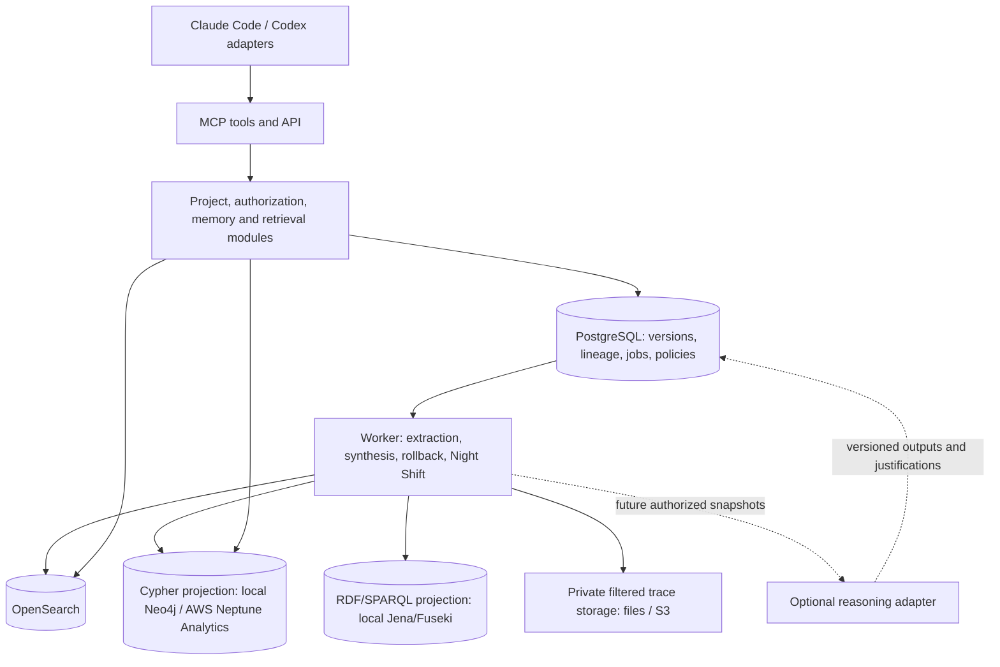

# Proposed architecture

## One application, a few local dependencies

Use a modular monolith: one codebase and release artifact, with API/MCP and worker
entry points. Run both on one machine. PostgreSQL provides durable transactions,
lineage adjacency, a job queue, and a transactional outbox. Avoid Kafka, Kubernetes,
distributed workflows, and a separate vector database initially.

Recommend TypeScript with strict types for API, MCP, integrations, and gym controller,
using the Codex TypeScript SDK. Use a small HTTP framework, schema validation, SQL
migrations, and an explicit data-access layer. Select/pin a supported Node LTS and
package manager at M0. Python may serve future evaluation/model components if
needed; introducing two application languages on day one is unnecessary.

## Ownership and consistency

PostgreSQL is the authoritative record of projects, members, policies, source and
memory versions, transformation inputs, derivations, retractions, jobs, and events.
Index text in OpenSearch for search; store only useful semantic/entity projections
in the graph. This deliberately adds a transactional authority to the spec's
search/graph stores. An unlinked memory still has complete provenance, but no
semantic graph node is required. This is an implementation proposal, not an
assertion about the original Context service.

Persist version plus outbox event in one transaction. Consumers use immutable
version IDs, monotonic generations, and idempotency keys; stale retries cannot
reactivate a retired version. Use job leases, checkpoints, retry limits, and
dead-letter inspection. The worker can restart independently of the API.

Search applies tenant and project filters before retrieval and reauthorizes returned
results and graph expansions. Membership removal invalidates access immediately
at the API boundary even if an index is stale. Read canonical publication metadata
to avoid exposing a retired version. Preserve the spec's availability during
pending rollback: the old published version may remain searchable until replaced;
the initiator sees pending exposure. Mark full completion only after closure checks
and required index/graph acknowledgements. Test source retraction racing with
synthesis, indexing, membership changes, and Night Shift.

The ledger stores versioned artifact identities and transformation input groups.
Design for multiple justification groups (AND inputs within a group; OR support
between groups) without implementing a formal inference engine now. Do not assume
all alternative sources justify every sentence in an LLM synthesis. Re-synthesis
must use surviving independent evidence, never contaminated prior prose. Acyclic
derivation records and cyclic semantic relationships are different structures.

## Search

Run real OpenSearch locally and target OpenSearch Serverless later. Implement BM25
plus vector retrieval and explicit fusion/reranking; choose the portable query
subset after checking the target Serverless collection type and supported APIs.
Application-side fusion is an option if search-pipeline features differ. Keep
analyzers, mappings, filters, embeddings model/version/dimension, and relevance
fixtures versioned. Compare lexical-only, vector-only, and hybrid against the same
judged query set. Exact identifiers, negation, scope, and temporal qualifiers matter.

Compute embeddings through a provider adapter, not a mandatory OpenSearch model
hosting plugin. Offer deterministic fixtures for tests and a real embedding provider
for meaningful semantic evaluation. Local embedding inference can be added if
offline operation is required. A fake embedding test is not evidence of semantic
quality. OpenSearch Serverless differs in auth, lifecycle, supported operations,
scaling and cost; run actual cloud conformance tests before claiming parity.

## Graph and future reasoning

Start with Neo4j Community as a candidate local property graph. Hide it behind
operations such as upsert entity/link, expand authorized neighbors, delete a
projection version, and inspect publication generation. Use parameterized basic
openCypher, stable application IDs, and application-enforced uniqueness as needed.
Avoid APOC, Neo4j-only procedures, constraints or graph algorithms in portable
queries. Pin the image and test exact types/null/list/ID semantics.

| Option | Advantage | Cost / limitation |
|---|---|---|
| Neo4j local + Neptune Analytics adapter | Familiar Cypher development; graph stays optional to memory ingestion | Different dialects/APIs; must qualify queries and algorithms on real Neptune |
| PostgreSQL adjacency only at first | Fewest dependencies | Less realistic Cypher development; acceptable only if user chooses to defer semantic graph |
| Separate RDF engine such as Jena/Fuseki | Local SPARQL and future validation/ontology work | Another projection/service; not Neptune Analytics emulation; recommended alongside Neo4j to meet confirmed SPARQL requirement |

The user confirmed SPARQL (RDF querying), not Apache Spark. Neither SPARQL nor
reasoning follows from Cypher support. Recommend Jena/Fuseki as a local RDF
projection alongside Neo4j, populated from the same versioned artifact ledger.
M1's RDF mapping covers memory/entity/provenance records, not inferred formal
claims; it exposes useful SPARQL without prematurely implementing M6. Use stable
IRIs, explicit version/scope metadata, and projection checkpoints. Do not expose
an unrestricted endpoint to agents: authorized service operations scope queries
and results, including metadata, to permitted projects. Test retraction and
publication consistency across RDF as well as search/Cypher.

This is two graph projections, not one dual-language engine. If a single local
graph process is essential, M0 must compare candidates and document compromised
parity instead of asserting both query languages behave like Neptune Analytics.
For AWS, decide whether SPARQL remains a development/export capability or needs a
deployed endpoint. A deployed endpoint needs Fuseki hosting or a separate RDF
service such as Neptune Database; Neptune Analytics cannot be assumed to replace it.

The source spec §28.3 distinguishes Neptune Analytics (openCypher) from Neptune
Database (RDF/SPARQL). Its AWS references could not be freshly retrieved in this
environment. Validate the current feature matrix in M0/M5. Do not promise a Neptune
reasoning engine or schedule. A future reasoner consumes authorized versioned
snapshots and returns results plus exact premise, rule, vocabulary, scope/time and
justification IDs through the ordinary publication/rollback pipeline. It can be an
external engine or a future AWS capability without becoming the memory authority.

## Host integration

Share MCP tools and service contracts across hosts. Keep lifecycle capture,
activation storage, context injection, and status presentation in host adapters.
Activation defaults to user + workspace and is snapshotted at session start.
Implement durable local upload spooling, duplicate handling, redaction, partial
session status, restart recovery, and end-of-session flushing. MCP tool availability
alone does not capture the full session.

The Codex SDK supports streamed events, working directories, resumed threads and
structured outputs. A controlled wrapper is a reliable first gym harness; do not
assume it provides every interactive CLI hook. Test interactive Codex support
separately. Claude Agent SDK documents MCP tools and hooks; Claude Code plugin
installation/status/session hooks still need a version-specific compatibility spike.
Use supported hooks or explicit wrappers, never pretend unsupported hooks exist.

## Runtime profiles and AWS

Proposed profiles: `test` (real storage with deterministic model fixtures), `dev`
(local storage and real model adapters), `gym-live` (real agents, bounded budgets),
and later `aws`. The user confirmed hosted model calls are acceptable; local
application services do not imply offline Codex/Claude inference. No local GPU
is required by this proposed workflow.

First AWS option: the same application container(s) on a single EC2 instance,
with managed storage where justified. A later option is ECS/Fargate for API and
worker. Recommend RDS PostgreSQL for durable state, S3 for private traces/artifacts,
OpenSearch Serverless and Neptune Analytics after conformance/cost checks. A
single compute host does not make the managed-service bill small. Use infrastructure
as code, workload identity, least-privilege roles, explicit retention, and tested
migrations/backups. Benchmark before choosing HA or capacity; no AWS resources
are provisioned by this proposal.
