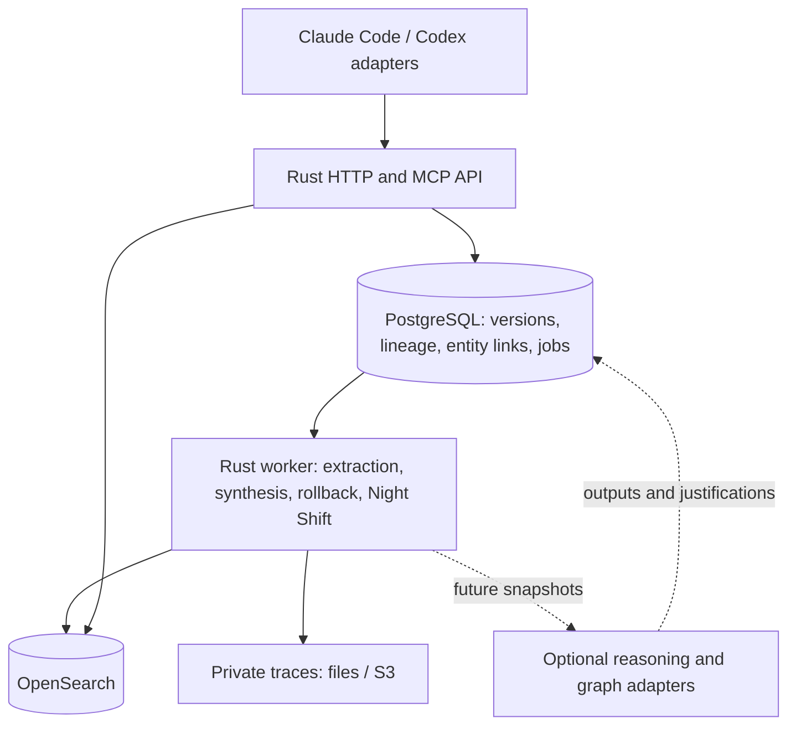

# Architecture: Rust, PostgreSQL and OpenSearch

## Confirmed direction

The user selected Rust for Spindle code and retained PostgreSQL and OpenSearch.
Dedicated graph engines, Cypher/SPARQL execution and formal reasoning are deferred.
Amazon Aurora DSQL is a candidate AWS store for graph-shaped relational data, not
an adopted deployment target. This supersedes the initial TypeScript, Neo4j and
Jena/Fuseki proposal; the supplied source spec remains unchanged.

## One application, two storage services

Use a Rust Cargo workspace and modular monolith with API/MCP, worker and CLI entry
points. Run these alongside PostgreSQL and OpenSearch on one machine. PostgreSQL
stores memory versions, evidence, lineage, entity links, jobs and a transactional
outbox. No separate graph server is required.

Candidate libraries: Tokio, Axum, Serde, SQLx, tracing/OpenTelemetry and a supported
MCP SDK/protocol adapter. Pin Rust, Cargo.lock and container versions in M0. Check
API and license compatibility before adopting crates. Keep domain rules independent
of the web framework, database driver and agent runtime.

Spindle-owned services, CLI, factory orchestration, scenario control and graders
are Rust. NeMo Gym and vendor runtimes remain external tools with their own language
dependencies. Prefer configuration and HTTP/JSONL/CLI boundaries. Identify any
necessary custom non-Rust glue as a scoped exception before introducing it.

## Graph-shaped data in PostgreSQL

Store source sessions, observations, memory versions and transformation inputs
explicitly. Keep derivation dependencies separate from semantic relationships:
the first must be acyclic; the second may contain cycles. Index both edge directions
with tenant/context/project scope. Use stable application-generated IDs.

Expose find parents/children, expand authorized neighbors, enumerate descendant
batches, inspect support and publish/retire version operations. Traverse in bounded
Rust batches with persisted frontiers/checkpoints; correctness need not depend on
recursive SQL or a graph extension. An unlinked memory still has complete lineage.
Basic relationship traversal stays in the prototype; Cypher/SPARQL endpoints wait.

PostgreSQL owns projects, members, policies, evidence, versions, retractions, jobs
and publication state. OpenSearch is a rebuildable retrieval projection. This adds
a transactional authority to the source spec's assumed Context backend.

## Consistency and reasoning boundary

Persist versions and outbox events in one transaction. Use immutable version IDs,
publication generations and idempotency keys so stale retries cannot reactivate
retired content. Jobs need leases, fencing, checkpoints, bounded retries and visible
failure states. Keep model/index calls outside retryable database transactions.

Authorize retrieval before search and reauthorize results and relationship expansion.
Membership removal takes effect at the API even when search is stale. Check canonical
publication state to exclude retired versions. Preserve availability during pending
rollback: the previous published version may remain searchable until replaced;
the initiator sees pending exposure. Full completion requires reconciled search
state and verified lineage closure.

Test retraction racing with derivation, indexing, policy changes and Night Shift.
Source/policy generation validation must participate in a transaction that detects
conflicting retraction/publication: a pre-write read alone is insufficient under
snapshot isolation. Start with a scoped guard/fencing design whose correctness and
contention can be measured. Never feed contaminated old prose into re-synthesis.

Versioned artifacts and transformation input groups should accommodate future
alternate justifications (AND inputs within a group, OR support between groups).
That does not require implementing inference now. At M6 reconsider typed claims,
RDF export, Cypher/SPARQL, validators and reasoners. A future engine consumes an
authorized snapshot and returns exact premises, rules, scope/time and justification
IDs through the same publication/rollback contract. No AWS roadmap is assumed.
DSQL is a relational store, not itself a Cypher, SPARQL or reasoning engine.

## Search

Run real OpenSearch locally and target Serverless later. Combine BM25 and vectors
with explicit fusion/reranking. Qualify supported APIs and collection types; use
application-side fusion if necessary. Version mappings, analyzers, filters,
embedding model/dimension and judged fixtures. Test exact identifiers, scope,
negation and time. Compute embeddings through a provider adapter. Deterministic
fixtures test the pipeline; real embeddings are needed for semantic-quality evidence.
Local OpenSearch does not establish Serverless API, auth, scale or cost parity.

## Aurora DSQL as an AWS candidate

AWS's official Rust SQLx sample demonstrates pooled IAM authentication and
optimistic-concurrency retries. PostgreSQL compatibility makes this promising,
but does not establish feature equivalence. Qualify the actual schema/workload
against current SQL, constraints, types, indexes, DDL and transaction limits.

Keep migrations and queue/outbox implementations behind adapters. Do not base
portable correctness on extensions, advisory locks, LISTEN/NOTIFY, SKIP LOCKED,
sequences, recursive CTEs or assumed constraint support. Their exact availability
requires checking; this is not a claim that all are unsupported. Prefer UUIDs,
bounded operations, optimistic versioned leases and fencing. Removing foreign keys
without a race-safe integrity design is not portability.

The DSQL spike must exercise conflict retries, idempotent publication, duplicate job
claims, retraction/publication races, token refresh, migrations/index readiness,
arbitrary-depth traversal, high fan-out and query cost. Real DSQL tests are required
before claiming support. Ordinary PostgreSQL (self-managed or RDS/Aurora PostgreSQL)
remains an alternative. If graph data is separated from the authoritative ledger,
its projection consistency needs an explicit design.

## Hosts and deployment

Share Rust MCP tools and service contracts. Host adapters own capture, activation,
injection and visibility. Activation defaults to user plus workspace and is frozen
per session. Provide durable upload spooling, redaction, deduplication, partial-session
status and recovery. MCP availability alone does not capture a transcript.

Use Codex structured CLI events or the qualified NeMo harness; the Rust product
need not depend on the TypeScript SDK. Claude Code/Agent SDK remains a requested
integration through supported host interfaces or an external SDK harness. Do not
pretend a native Rust Claude Agent SDK exists. Test interactive hosts separately
from gym wrappers.

Profiles: test (real storage/deterministic models), dev (local services/hosted models),
gym-local (NeMo/Docker after qualification), optional gym-daytona, and later AWS.
No local GPU is required. First AWS compute option is the same Rust containers on
one EC2 machine; ECS/Fargate can follow. Use S3, qualify OpenSearch Serverless, and
select PostgreSQL versus DSQL after the storage spike. Use infrastructure as code,
workload identity and tested migrations/restore. No resources have been provisioned.
